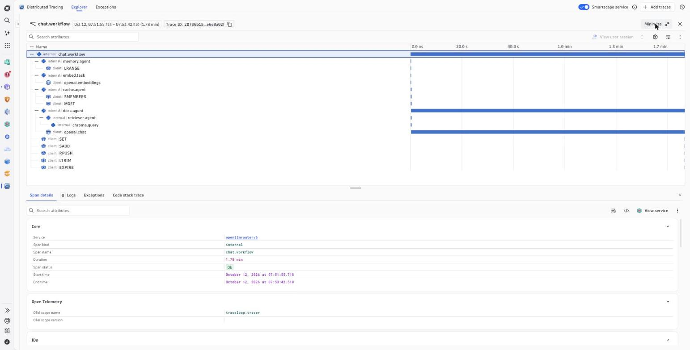
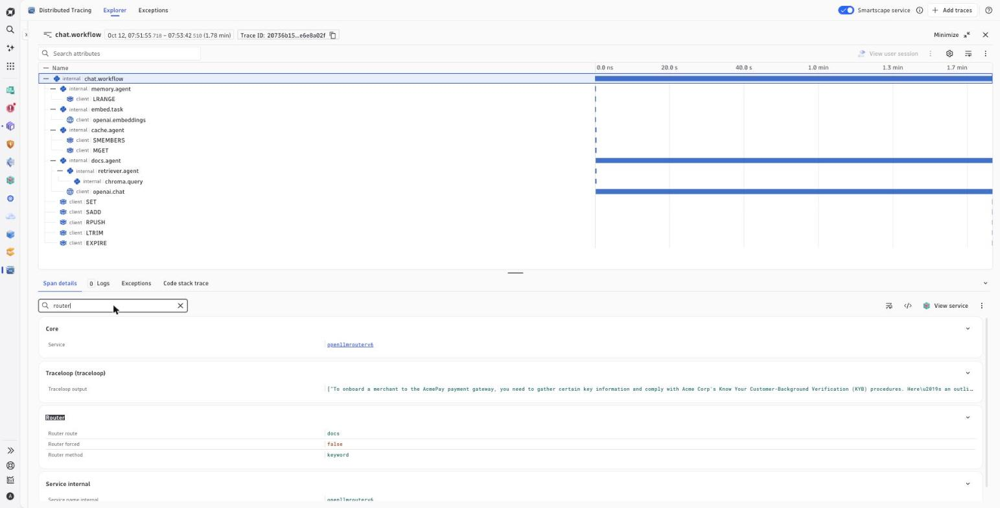
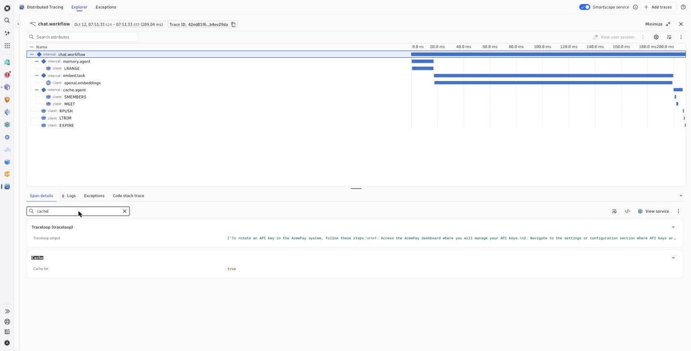
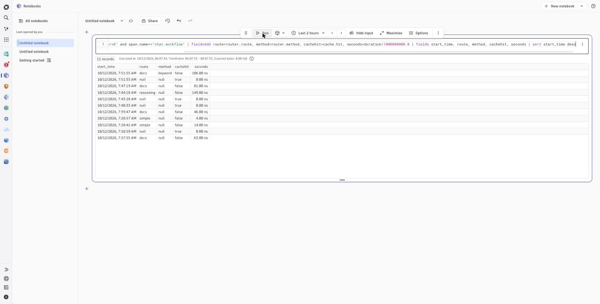

# v6 — Redis cache + memory, Chroma RAG

Builds on [`v5-router`](../v5-router). Same router, plus the three things a real
LLM app grows next: a **cache**, **memory**, and its own **documents** — each one
a backend Dynatrace captures with no extra instrumentation code.

Runs on `:8082` as service **openllmrouterv6**, side by side with v4/v5.

## What changed vs v5

- **Redis semantic cache** — before routing, the question is embedded and
  cosine-matched against cached answers. A hit returns immediately and skips the
  LLM entirely. Recorded as `cache.hit` / `cache.score`.
- **Redis conversation memory** — chat history is persisted per
  `conversation_id` in a Redis list (`conv:<id>`); Redis is the source of truth
  for context, so the client can send only the new turn. Recorded as `conv.turns`.
- **Chroma vector DB + document RAG** — docs in [`kb/`](kb) are chunked, embedded
  (`nomic-embed-text`) and stored in Chroma. A new **`docs`** route retrieves the
  relevant chunks and answers only from them. Recorded as `rag.sources` /
  `rag.results` / `rag.top_score`.
- **Router docs keyword pre-filter** — questions mentioning a KB term skip the
  LLM router and go straight to `docs` (deterministic, faster). Recorded as
  `router.method` (`keyword` | `llm` | `forced`).

Routes are now: `simple | reasoning | research | docs | blocked`.

## The request pipeline

```
chat.workflow
  embed(question)
  -> Redis semantic cache lookup            [cache.hit / cache.score]  — hit: return, no LLM
  -> route (keyword pre-filter or LLM)       [router.route / router.method]
       docs -> retriever -> Chroma query     [rag.sources / rag.results]
  -> store answer in Redis cache
  -> append the turn to Redis memory
```

## How Dynatrace captures it

OpenLLMetry (`traceloop-sdk`) exports OTLP straight to Dynatrace. Redis, Chroma
and the LLM/embeddings are **auto-instrumented** — their calls show up as spans
with no extra code:

- Redis: `SMEMBERS`, `MGET`, `SET`, `SADD`, `LRANGE`, `RPUSH`, `LTRIM`, `EXPIRE`
- Chroma: `chroma.query`
- LLM: `openai.chat`, `openai.embeddings`

The business decisions (`router.route`, `router.method`, `cache.hit`,
`rag.sources`, `conv.turns`) are set as span attributes you can filter, group,
chart and alert on.

## Proof (see [`docs/`](docs))

| | |
|---|---|
|  | **One `chat.workflow` trace** for a docs question: `memory → embed → cache → docs → retriever → chroma.query → openai.chat`, plus the Redis command spans. |
|  | The routing decision as **span attributes**: `router.route = docs`, `router.method = keyword`. |
|  | A **cache hit**: 209 ms, `cache.hit = true`, no router/docs/chroma/`openai.chat` span — the LLM was skipped. |
|  | DQL in a Notebook: the same KYB-style question was `reasoning` before the keyword pre-filter and `docs` after. |

## Run

```sh
cp .env.example .env     # fill in your tenant + token

# a local Redis (cache + memory)
docker run -d --name redis6 -p 6379:6379 redis:7-alpine

# a local Ollama with the chat + embedding models
ollama pull qwen2.5:1.5b qwen2.5:3b nomic-embed-text

pip install -r requirements.txt
./run.sh v1              # or v2 / v3
```

Open http://localhost:8082. On start it ingests `kb/` into Chroma. Ask an
AcmePay question (docs route), then ask it again (cache hit).

Self-check, no network: `python app.py --selftest` (covers the cosine + cache +
memory logic with a fake Redis).

## Request contract

```
POST /chat
{"messages": [...], "conversation_id": "...", "route": "auto"|"simple"|"reasoning"|"research"|"docs"}
```
